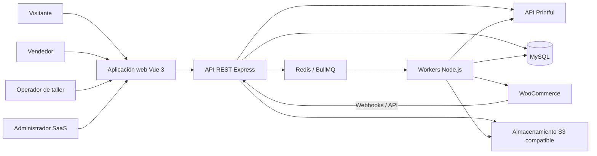
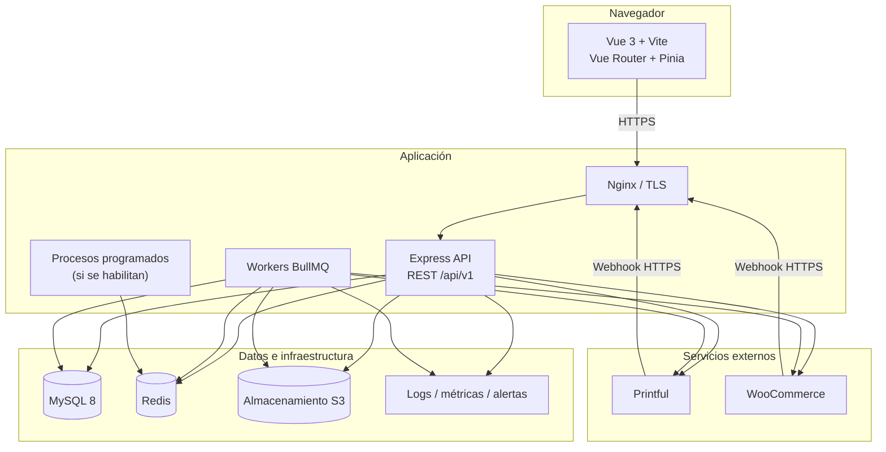
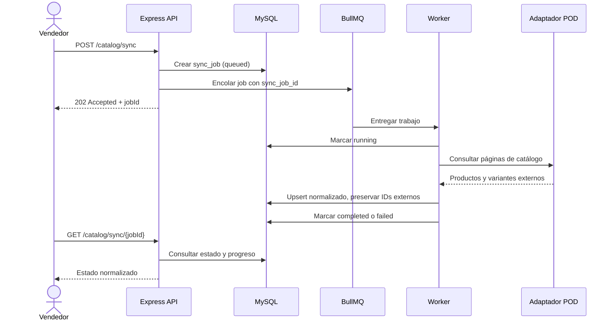

# Arquitectura del sistema: plataforma Print on Demand

**Versión:** 1.0  
**Fecha:** noviembre de 2026  
**Estado:** propuesta de arquitectura  
**Documento de referencia:** [Especificación de la plataforma](./especificacion_plataforma_print_on_demand_vue3_express.md)

## 1. Propósito

Este documento convierte los requisitos funcionales y técnicos de la especificación en una arquitectura lógica y de ejecución para una plataforma SaaS de Print on Demand. Define responsabilidades, límites entre módulos, flujos principales, persistencia, integraciones y controles transversales.

La arquitectura prioriza la fabricación propia como flujo principal: cada tenant administra productos, máquinas, materiales, trabajos de producción e información de envío. Printful es un adaptador externo opcional para productos que el usuario marque expresamente; ni la operación diaria ni el catálogo interno dependen de sus credenciales. La integración con tiendas puede añadirse mediante adaptadores sin trasladar particularidades externas al dominio central.

## 2. Alcance y supuestos

### Incluido

- Sitio público y aplicación autenticada en Vue 3.
- API REST en Express.
- Aislamiento lógico de datos por tenant.
- Catálogo, diseños, productos, precios, tiendas y pedidos.
- Fabricación interna mediante equipos, inventario de materiales, recetas por producto, cola de trabajos y registro de envíos.
- Integración de proveedor POD mediante adaptador opcional, inicialmente Printful.
- Integración de tienda mediante adaptador, inicialmente WooCommerce.
- Procesamiento asíncrono, webhooks, auditoría y notificaciones.
- Suscripciones y administración SaaS como capacidades posteriores al flujo operativo inicial.

### Fuera de alcance

- Automatización industrial o comunicación directa con firmware/controladores de máquinas; los equipos se gestionan como recursos operativos.
- Procesamiento directo de pagos de clientes finales.
- Replicación de las funciones internas de Printful.
- Compromisos de disponibilidad, volúmenes o tiempos de respuesta no establecidos en la especificación.

### Supuestos que deben confirmarse

1. La plataforma será multi-tenant y cada vendedor administrará sus propias conexiones.
2. WooCommerce será el primer canal externo, si se incluye en el MVP.
3. Las órdenes al proveedor requerirán confirmación del vendedor inicialmente; la automatización será configurable.
4. MySQL será la fuente de verdad de los datos comerciales internos.
5. Redis/BullMQ procesará tareas de duración variable; no será fuente de verdad de pedidos ni de estados de negocio.
6. La instalación local guarda artes raster privados en el filesystem del backend; producción multi-instancia debe migrar a almacenamiento de objetos privado compatible con S3.

## 3. Principios y decisiones arquitectónicas

1. **Monolito modular primero:** una aplicación Express organizada por dominios reduce complejidad operativa en el MVP. Sus límites internos permiten extraer servicios solo si existe una necesidad demostrada.
2. **Dominio independiente de proveedores:** los servicios de negocio dependen de contratos y modelos internos, no de SDK, nombres de campos ni estados particulares de Printful o WooCommerce.
3. **Aislamiento multi-tenant en backend:** el tenant activo se obtiene de la identidad y membresía autenticadas. Nunca se acepta como autoridad un `tenant_id` suministrado por el cliente.
4. **Persistencia duradera antes de trabajo asíncrono:** se registra la operación en MySQL antes de encolarla. La cola distribuye trabajo; MySQL conserva la trazabilidad y el estado de negocio.
5. **Idempotencia en límites externos:** webhooks, importaciones y envíos al proveedor pueden repetirse sin duplicar efectos internos ni externos.
6. **Estados internos explícitos:** se conservan los estados originales de terceros y se mapean a estados internos sin asumir equivalencia uno a uno.
7. **Dinero como datos auditables:** importes con `DECIMAL`, moneda explícita, y snapshots de precios/costos al recibir la orden.
8. **Errores visibles y recuperables:** fallos externos se normalizan, registran y exponen como estados operativos accionables; no se ocultan mediante respuestas exitosas genéricas.
9. **Secretos siempre en backend:** credenciales de proveedores no se envían a Vue ni se incluyen en logs.
10. **Fabricación local por defecto:** los productos nuevos tienen `fulfillmentMode=in_house`; Printful solo se invoca para productos que declaran explícitamente ese proveedor.
11. **Consumo de inventario transaccional:** al iniciar un trabajo, se validan y descuentan sus materiales dentro de la misma transacción; la marca `materialsConsumedAt` impide cobrar dos veces el consumo al reanudar un trabajo bloqueado.

## 4. Vista de contexto



### Sistemas externos

| Sistema | Propósito | Dirección de integración | Confiabilidad asumida |
|---|---|---|---|
| Printful | Catálogo, mockups cuando estén disponibles, fulfillment y tracking | API saliente y webhooks entrantes | Puede aplicar límites, retrasos, errores o cambios de contrato |
| WooCommerce | Publicación de productos e importación de pedidos | API saliente y webhooks entrantes | Webhooks pueden repetirse, llegar tarde o no llegar |
| Archivos privados del backend | Artes PNG/JPG/WebP asociados a tenant | API autenticada | En local viven bajo `apps/api/uploads/artwork`; usar almacenamiento de objetos privado en producción multi-instancia |
| Redis | Transporte y coordinación de tareas | Backend y workers | Recuperable; no sustituye la persistencia principal |

## 5. Vista de contenedores



### Responsabilidades

- **Vue SPA:** presentación, validación de experiencia de usuario, navegación y estado de vista. No aplica reglas de autorización definitivas ni se conecta con APIs privadas de terceros.
- **Nginx:** terminación HTTPS, entrega de recursos del frontend, proxy a Express y límites básicos de transporte. La configuración concreta debe evitar exponer rutas internas o archivos privados.
- **Express API:** autenticación, autorización, validación, reglas de dominio, acceso a repositorios, creación de trabajos y recepción duradera de webhooks.
- **Workers:** procesamiento de operaciones lentas/reintentables; actualizan registros de MySQL y emiten eventos/notificaciones.
- **MySQL:** fuente de verdad para identidades, tenants, recursos comerciales, operaciones, snapshots e historial.
- **Redis/BullMQ:** cola de ejecución, reintentos y control de concurrencia. Una pérdida de Redis no debe perder el único registro de una orden o evento.
- **Artes:** el backend guarda originales raster con nombre aleatorio en filesystem local; MySQL mantiene MIME, tamaño, tenant y clave. La lectura requiere sesión del mismo tenant. El filesystem local no sustituye almacenamiento de objetos duradero en producción multi-instancia.

## 6. Descomposición del backend

El backend se organiza como monolito modular. Cada módulo posee sus reglas, casos de uso y acceso a datos; los controladores HTTP son adaptadores del borde y no contienen lógica de negocio.

| Módulo | Responsabilidades principales | Dependencias permitidas |
|---|---|---|
| `auth` | Registro, login, renovación/cierre de sesión, recuperación | usuarios, sesiones/tokens |
| `tenants` | Tenants, membresías, roles y resolución del contexto | auth |
| `users` | Perfil y preferencias de usuario | auth |
| `providers` | Conexiones de cuentas POD, cifrado y estado de conexión | adaptadores POD, tenants |
| `catalog` | Catálogo interno de fabricación y consulta opcional de catálogos externos | products, providers |
| `designs` | Diseños, archivos, versiones y validación de medios | almacenamiento, tenants |
| `mockups` | Previsualización local SVG y exportación PNG desde el navegador | designer, products |
| `products` | Productos comerciales, variantes, modo de fulfillment y configuración de fabricación | catalog, designs, pricing |
| `pricing` | Costos, reglas, monedas, cotizaciones y snapshots | catálogo y productos |
| `stores` | Conexiones de ecommerce y productos publicados | adaptadores ecommerce |
| `orders` | Ingesta, deduplicación, validación y ciclo de vida de pedido | stores, products, pricing |
| `production` | Equipos, materiales, recetas, consumo, estados e historial de trabajos | orders, products, inventario |
| `fulfillment` | Envío, consulta y cancelación de órdenes a proveedores externos opcionales | orders, providers |
| `shipping` | Envíos propios, tracking y normalización de estados | production, fulfillment |
| `webhooks` | Verificación, almacenamiento, deduplicación y encolado de eventos | providers, stores, cola |
| `notifications` | Avisos internos y canales habilitados | eventos de dominio |
| `billing` | Planes, suscripciones, límites y facturación SaaS | tenants |
| `admin` | Administración y soporte con autorización reforzada | módulos de dominio |
| `audit` | Registro de acciones sensibles y cambios relevantes | middleware/casos de uso |

### Estructura lógica sugerida

```text
backend/src/
  app/
    create-app.ts
    routes.ts
  config/
  database/
    migrations/
    repositories/
  middleware/
    authenticate.ts
    require-tenant.ts
    authorize.ts
    validate-request.ts
    error-handler.ts
  modules/
    orders/
      order.routes.ts
      order.controller.ts
      order.schemas.ts
      order.service.ts
      order.repository.ts
      order.types.ts
    fulfillment/
    catalog/
    ...
  integrations/
    providers/
      provider.port.ts
      printful/
    ecommerce/
      ecommerce.port.ts
      woocommerce/
  jobs/
    queues.ts
    processors/
  observability/
```

La estructura anterior es una guía, no una obligación de crear un archivo por cada responsabilidad. Mantener módulos cohesionados y evitar dependencias circulares.

## 7. Puertos y adaptadores de integración

### 7.1 Proveedores POD

Los casos de uso deben depender de una interfaz de dominio equivalente a:

```ts
interface PodProviderPort {
  getCatalog(input: CatalogQuery): Promise<ProviderCatalogPage>;
  getProduct(externalProductId: string): Promise<ProviderProduct>;
  getVariants(externalProductId: string): Promise<ProviderVariant[]>;
  createMockup(input: CreateMockupInput): Promise<MockupJob>;
  createOrder(input: CreateFulfillmentOrderInput): Promise<ProviderOrderResult>;
  getOrder(externalOrderId: string): Promise<ProviderOrder>;
  cancelOrder(externalOrderId: string): Promise<ProviderOrder>;
}
```

El contrato real debe representar solo operaciones que el proveedor y el tipo de autorización soporten. El adaptador de Printful traduce modelos internos a la API oficial, aplica autenticación, timeout, límites, clasificación de errores y mapeo de respuestas/estados.

### 7.2 Tiendas

Definir un puerto equivalente para canales de ecommerce, con operaciones separadas para probar conexión, publicar/actualizar producto, importar pedidos y consultar el estado publicado. Webhooks de cada canal se normalizan a eventos internos. No se debe inferir que WooCommerce y canales futuros comparten los mismos campos o políticas.

### 7.3 Reglas de integración

- Credenciales cifradas en reposo y descifradas solo en el límite de integración.
- Timeout en todas las llamadas de red.
- Reintentos con backoff solo cuando la operación es segura o su idempotencia está garantizada.
- Errores externos con categoría estable (`auth`, `rate_limit`, `validation`, `unavailable`, `unknown`) y referencia de correlación.
- No guardar cuerpos externos con datos personales innecesarios; sanitizar antes de persistir o registrar.
- Conservar identificadores externos y proveedor/canal junto a las entidades internas.
- Confirmar rutas, permisos, esquema de autorización y firmas con documentación oficial vigente antes de implementar cada operación.

## 8. Modelo de datos y propiedad

MySQL es la autoridad para el estado interno. Todas las tablas comerciales deben quedar vinculadas a un tenant de forma directa o mediante una relación que permita comprobarlo en cada acceso.

### Agregados principales

| Agregado | Raíz | Entidades relacionadas | Invariantes |
|---|---|---|---|
| Cuenta | `tenant` | `tenant_users`, plan/suscripción | Membresía y rol válidos; tenant activo |
| Conexión POD | `provider_account` | token cifrado, catálogo externo | La conexión pertenece al tenant; secretos nunca serializados al cliente |
| Diseño de producto | `product.designConfig` | plantilla, posición, escala, rotación, cara y archivo raster | Área de impresión controlada por la plantilla; el archivo pertenece al tenant |
| Arte raster | `ProductArtworkAsset` | propietario tenant, clave aleatoria, MIME y tamaño | PNG/JPG/WebP, máximo 5 MB y 50 MP; acceso autenticado y aislado por tenant |
| Producto | `product` | variantes, modo interno/externo, plantilla, arte y configuración visual | Fabricación interna por defecto; variantes creadas con selección de tallas y colores |
| Tienda | `store` | publicaciones, pedidos | Conexión y pedidos están aislados por tenant |
| Pedido | `order` | partidas, fulfillments, envíos, historial de estado | Clave externa única por tienda; precios/costos de venta preservados |
| Evento externo | `webhook_event` | resultado de procesamiento | Dedupe por proveedor/canal e ID externo o huella definida |
| Trabajo | `sync_job` | intentos y error normalizado | Estado durable y correlacionable con tarea en cola |

### Reglas de persistencia

- Usar UUID/ID interno estable, más identificadores externos en columnas separadas.
- Restricciones únicas para `(store_id, external_order_id)` y `(provider_account_id, external_id)` cuando corresponda.
- Indexar `tenant_id`, estados, fechas y claves de consulta; validar los índices con patrones reales de uso.
- Usar `DECIMAL` para dinero y almacenar `currency` en cada importe relevante.
- Guardar precio de venta, costo del proveedor, envío, impuestos y tipo de cambio como snapshots asociados al pedido/partida.
- Conservar historial de cambios de estado con fecha, origen y referencia externa; no depender solo del valor actual.
- Evitar borrado físico de pedidos, operaciones financieras y eventos procesados.
- Aplicar políticas de retención y eliminación de datos personales conforme a los mercados objetivo.
- Las migraciones deben ser versionadas, revisables y reversibles cuando sea viable.

## 9. Flujos críticos

### 9.1 Sincronización del catálogo



El endpoint de solicitud responde sin esperar el proceso completo. El job guarda progreso y error seguro para consulta. Las escrituras de catálogo deben ser repetibles sin crear duplicados.

### 9.2 Ingesta de pedido desde tienda

1. Recibir webhook en una ruta pública específica del canal.
2. Validar autenticidad con el mecanismo vigente del proveedor.
3. Validar estructura mínima y guardar el evento recibido de forma duradera.
4. Responder al proveedor dentro del plazo esperado, una vez persistido el evento.
5. Encolar el procesamiento usando un identificador de evento estable.
6. Resolver la tienda y tenant desde la conexión verificada, no desde un dato libre del payload.
7. Aplicar deduplicación por tienda e ID externo del pedido.
8. Normalizar partidas, moneda, importes y direcciones necesarias para fulfillment.
9. Guardar snapshots y estado inicial dentro de una transacción.
10. Validar que variantes, diseños y mapeos estén disponibles; dejar el pedido en `action_required` si necesita intervención.

Si la firma no es válida, el payload está mal formado o no se puede asociar a una conexión, registrar el rechazo con datos mínimos y no procesar el pedido como legítimo.

### 9.3 Envío de pedido a fulfillment

```mermaid
sequenceDiagram
    actor Seller as Vendedor
    participant API as Express API
    participant DB as MySQL
    participant Q as BullMQ
    participant W as Worker
    participant POD as Printful

    Seller->>API: POST /orders/{id}/submit
    API->>DB: Verificar tenant, estado, aprobación y partidas
    API->>DB: Crear intento fulfillment + clave idempotente
    API->>Q: Encolar fulfillment_id
    API-->>Seller: 202 Accepted + operación
    Q->>W: Entregar fulfillment
    W->>DB: Reclamar operación de forma atómica
    W->>POD: Crear orden usando referencia idempotente soportada
    alt Respuesta confirmada
        POD-->>W: ID externo y estado
        W->>DB: Guardar referencia y estado
    else Resultado ambiguo o timeout
        W->>POD: Consultar orden por referencia externa si está soportado
        POD-->>W: Resultado encontrado o incertidumbre explícita
        W->>DB: Marcar reconciliación pendiente; no enviar a ciegas
    end
```

La plataforma genera una clave de idempotencia interna por operación de fulfillment. Si el proveedor no admite una clave idempotente compatible, la estrategia debe apoyarse en una referencia externa única y reconciliación antes de repetir. No se reintenta automáticamente una creación cuyo resultado sea incierto.

### 9.4 Webhook de proveedor

El endpoint verifica y persiste el evento, responde y delega el trabajo. El procesador deduplica, mapea el estado externo a uno interno, conserva el payload relevante sanitizado, actualiza historial y estado de envío, y emite una notificación si corresponde. Eventos fuera de orden no deben hacer retroceder un estado interno sin una regla explícita; conservar tiempo/versión externa cuando exista y enviar conflictos a reconciliación.

### 9.5 Fabricación y envío propios

1. Cada producto usa `in_house` por defecto; un producto externo debe declarar explícitamente `printful`.
2. Al registrar una orden, se crean en la misma transacción los trabajos de producción de cada partida interna y su primer registro de historial.
3. El operador asigna un equipo activo y avanza el trabajo por `queued → prepress → ready → in_production → quality_check → packed`.
4. Al entrar en `in_production`, una transacción verifica el equipo, comprueba los requisitos de materiales, descuenta existencias y registra movimientos. `materialsConsumedAt` hace idempotente el consumo al reanudar trabajos bloqueados.
5. Si el inventario no alcanza, la transición falla sin cambiar el trabajo ni descontar parcialmente otros materiales.
6. Después de empacar, el operador registra paquetería y rastreo; esto crea el envío y mueve el trabajo a `shipped`. La orden solo cambia a entregada cuando todos sus artículos corresponden a fabricación interna y todos sus trabajos se completan.
7. El tenant se resuelve desde la sesión autenticada en cada operación; productos, equipos, inventario, trabajos y envíos se consultan y mutan dentro de ese tenant.

Los equipos se administran como recursos de taller configurables por tecnología, sin asumir un protocolo o conexión de control con la máquina. La integración física automatizada queda fuera del alcance de esta entrega.

### 9.6 Diseño de productos y mockups locales

1. El diseñador consulta una biblioteca versionada de plantillas internas (ropa, bebidas, accesorios, hogar, decoración y una plantilla plana genérica); cada plantilla define materiales, técnicas, tamaños, forma visual y área imprimible normalizada.
2. El operador selecciona la plantilla y colores/tallas, sube un arte raster validado o escribe texto, y posiciona/escalan/rota el contenido dentro del área en la previsualización vectorial. Las vistas de frente/reverso muestran detalles constructivos distintos para las plantillas; un `designConfig` representa el lado seleccionado, no dos artes independientes.
3. La exportación PNG es local en el navegador; guardar el producto persiste en MySQL `productType`, `designConfig`, variantes y referencia opcional de arte. Los productos diseñados pueden abrirse de nuevo para editar configuración, texto/arte, datos y variantes (combinaciones, nombre, SKU, costo y precio); los cambios de variantes se aplican transaccionalmente y las variantes existentes conservan su ID y costo/precio salvo que se editen. Se permite desvincular arte. No se envía el archivo o la posición a Printful.
4. El cliente HTTP aplica un timeout de 15 segundos y muestra un error accionable si la API no responde; las operaciones de guardado indican su estado y no dejan la interfaz en espera indefinida.
5. Los artes aceptados son PNG, JPEG y WebP, hasta 5 MB, 10000 píxeles por lado y 50 megapíxeles. La tabla de assets almacena MIME, tamaño y clave generada; los endpoints de subida, lectura y eliminación verifican tenant y permisos.
6. El mockup es una referencia visual, no un archivo listo para la máquina. El perfil de máquina, calibración, sangrado, resolución efectiva y dimensiones físicas deben configurarse y validarse antes de activar exportación de producción.

## 10. API y contratos

- Prefijo: `/api/v1`.
- JSON para operaciones de negocio; carga de archivos mediante endpoints de carga controlada o URLs firmadas, de acuerdo con la implementación.
- Operaciones lentas retornan `202 Accepted` con un `jobId` o `operationId`.
- Errores usan un formato consistente con código estable, mensaje seguro, referencia de soporte y detalles de validación cuando sean apropiados.
- Paginación y filtros explícitos para catálogo, productos y pedidos.
- Validar todas las entradas en servidor mediante esquemas; no confiar en validación frontend.
- Aplicar autorización en cada operación y verificar tenant tanto en consultas como en mutaciones.
- Acciones críticas (`publish`, `submit`, `cancel`) se modelan como comandos específicos, no como cambios arbitrarios de estado enviados por el cliente.
- Webhooks permanecen fuera de la sesión normal de usuario, pero deben autenticar criptográficamente o según mecanismo oficial de cada integración.

## 11. Seguridad y privacidad

### Identidad y permisos

- Contraseñas con Argon2id o bcrypt configurado adecuadamente.
- Preferir cookie de sesión `HttpOnly`, `Secure`, `SameSite` y protección CSRF si la estrategia es cookie; si se elige JWT, refresh tokens rotatorios, revocación y almacenamiento seguro.
- Roles iniciales: `owner`, `admin`, `editor`, `viewer`; definir permisos por acción.
- Autorización server-side para rutas de usuario, tenant y administrador.
- Rate limiting en autenticación, recuperación, conexiones y endpoints sensibles.

### Datos y secretos

- Cifrado de tokens de integración con gestión de claves fuera de la base de código y política de rotación.
- No devolver tokens, claves ni secretos en errores, trazas, analítica o respuestas HTTP.
- Minimización de datos personales de clientes finales; restringir acceso por función y registrar consultas administrativas sensibles.
- Mantener secretos fuera del frontend y del repositorio.

### Archivos

- Verificar MIME real, extensión permitida, dimensiones y tamaño.
- Rechazar formatos ejecutables y procesar archivos en un entorno limitado.
- Almacenar objetos en bucket privado con claves internas no predecibles.
- Emitir URLs firmadas de corta duración cuando se necesite acceso temporal.
- Si se importan recursos remotos, permitir solo destinos controlados y bloquear rangos internos para mitigar SSRF.
- Aplicar análisis antimalware cuando esté disponible y mantener estado de procesamiento/rechazo.

### Webhooks y auditoría

- Verificar firma/token según mecanismo documentado; implementar protección contra replay cuando el proveedor ofrezca timestamp o nonce.
- Guardar ID de evento, proveedor, fecha y resultado de validación.
- Sanitizar payload y limitar retención de datos.
- Auditar cambios de credenciales, roles, publicación, envío/cancelación de órdenes y acciones administrativas.

## 12. Consistencia, colas y recuperación

### Estados de trabajos

Los trabajos persistidos en `sync_jobs` u operación equivalente tendrán como mínimo: `queued`, `running`, `completed`, `failed`, `retrying`, `needs_review` o `cancelled`; incluir tipo, tenant, recurso, timestamps, intentos, error normalizado y correlación.

BullMQ ofrece entrega al menos una vez en escenarios recuperables, por lo que todos los procesadores deben ser idempotentes. Configurar concurrencia y límites de tasa por proveedor/cuenta; aplicar backoff exponencial acotado y cola de fallos para intervención manual.

### Consistencia entre MySQL y Redis

No existe una transacción distribuida entre MySQL y Redis. Para evitar el estado “registro guardado, job no encolado”, usar uno de estos patrones:

1. **Outbox transaccional (recomendado cuando la fiabilidad lo requiera):** registrar operación y mensaje outbox en la misma transacción MySQL; un publicador despacha a BullMQ y marca el mensaje enviado.
2. **Reconciliación periódica:** para un MVP pequeño, detectar operaciones persistidas sin tarea correspondiente y reenviarlas de manera idempotente.

La selección debe ser explícita en la implementación. No tratar una confirmación de encolado como sustituto del registro de operación en MySQL.

### Recuperación operativa

- Reintento manual de jobs fallidos con control de permisos y registro de auditoría.
- Reconciliación de pedidos y fulfillments con proveedor/canal para resultados ambiguos.
- Herramientas de administración para inspeccionar estado, intentos y referencias sin exponer secretos.
- Procedimientos para pausar temporalmente una integración cuando exceda límites o falle de forma sostenida.

## 13. Despliegue y topología inicial

### MVP

```text
Internet
  └── Nginx con HTTPS
      ├── Recursos estáticos Vue
      └── Express API
          ├── MySQL gestionado o instancia persistente
          ├── Redis
          └── Almacenamiento S3 privado

Proceso Worker (Node.js)
  ├── Redis / BullMQ
  ├── MySQL
  ├── Printful
  └── WooCommerce
```

API y worker pueden desplegarse inicialmente en la misma infraestructura, pero como procesos separados para escalar y reiniciar de forma independiente. PM2 puede supervisar procesos en una máquina; si la plataforma crece, sustituir o complementar con contenedores y un orquestador según necesidades.

### Entornos

- **Local:** servicios y credenciales de prueba; datos sintéticos.
- **Staging:** credenciales sandbox/prueba disponibles, URLs de webhook accesibles y pruebas end-to-end.
- **Producción:** secretos administrados, TLS, backups verificados, alertas, rotación y acceso operativo restringido.

Variables públicas `VITE_` contienen únicamente configuración no secreta del frontend. Las credenciales POD, ecommerce, almacenamiento, DB y cifrado son secretos server-side.

### Evolución

Escalar primero por proceso: más instancias API sin estado, workers independientes por cola y límites, almacenamiento de objetos gestionado y MySQL con backups/replicas según carga. Extraer servicios solo ante límites medidos de escalado, aislamiento operacional o propiedad de equipos; no iniciar con microservicios.

## 14. Observabilidad y operación

- Logs estructurados con `requestId`, `jobId`, `tenantId` cuando sea seguro, módulo, operación y resultado.
- Nunca incluir tokens, contraseñas, secretos, datos de pago ni payloads personales completos.
- Métricas mínimas: tasa de errores API, latencia, disponibilidad de DB/Redis, profundidad/antigüedad de colas, jobs fallidos, retraso de webhooks, sincronizaciones pendientes y órdenes en `action_required`.
- Propagar una correlación de API a trabajo asíncrono y llamada externa.
- Alertar sobre errores sostenidos de proveedor, crecimiento de cola, jobs agotados y fallas de backup.
- Mantener readiness/liveness para procesos y procedimientos de despliegue/rollback.
- Definir objetivos de recuperación (RPO/RTO), retención de logs y ventanas de mantenimiento antes de producción; la especificación no fija esos objetivos.

## 15. Pruebas arquitectónicas

1. **Unitarias:** reglas de precios, transiciones de estado, validadores, mapeo de estados y errores de adaptadores.
2. **Integración:** repositorios MySQL, tenant scoping, persistencia de webhook y ejecución de workers.
3. **Contratos:** adaptadores contra fixtures/documentación de API; probar esquemas y clasificación de errores.
4. **End-to-end:** conectar cuenta de prueba, consultar catálogo, guardar diseño, crear producto, importar pedido, confirmar y reconciliar fulfillment.
5. **Resiliencia:** duplicación de webhook, timeout al crear orden, Redis temporalmente no disponible, rate limit y eventos fuera de orden.
6. **Seguridad:** acceso cruzado entre tenants, escalamiento de roles, CSRF según autenticación, carga de archivo inválido y exposición accidental de secretos.

Las pruebas con servicios reales deben usar cuentas de prueba y no disparar fabricación o cargos sin confirmación explícita del entorno.

## 16. Decisiones pendientes

| Decisión | Recomendación inicial | Consecuencia |
|---|---|---|
| ¿Multi-tenant o tienda única? | Multi-tenant lógico desde el inicio, según alcance del producto | Tenant scoping en todos los repositorios y pruebas |
| ¿Quién conecta Printful? | Cada vendedor conecta su cuenta, sujeto a las opciones de autorización vigentes | Tokens y permisos asociados a tenant/cuenta |
| ¿Canal inicial? | WooCommerce si es requisito comercial confirmado | Limita el primer adaptador ecommerce y pruebas |
| ¿Envío automático? | Requerir aprobación en MVP; habilitar política automática explícita después | Reduce errores de catálogo/costo y pedidos no autorizados |
| ¿Sesiones o JWT? | Cookie segura para SPA propia, si encaja con despliegue y CSRF | Simplifica revocación; exige configuración de CSRF |
| ¿ORM/acceso a datos? | Elegir Prisma, Knex o mysql2 y mantener una sola estrategia | Afecta migraciones, transacciones y tipado |
| ¿Carga directa o vía API? | URLs firmadas si el volumen/tamaño lo amerita; en otro caso API con límites | Complejidad de permisos y limpieza de cargas incompletas |
| ¿Outbox desde MVP? | Outbox si la pérdida de despacho no es aceptable; reconciliación como opción inicial más simple | Consistencia durable MySQL/Redis |
| ¿Monedas/mercados? | Definir un conjunto inicial antes de modelar conversión e impuestos | Reglas de cálculo y snapshots fiscales |
| ¿Pagos/facturación SaaS? | Posponer hasta validar flujo POD | Evita mezclar cobro de la plataforma con cobro de tiendas |

## 17. Riesgos y mitigaciones

| Riesgo | Mitigación arquitectónica |
|---|---|
| Pedido enviado dos veces | Clave interna por fulfillment, control atómico de estado, referencia externa e indagación antes de reintentar |
| Webhook repetido o perdido | Persistencia antes de respuesta, deduplicación, procesamiento idempotente y reconciliación |
| Fallo entre DB y cola | Outbox o detección periódica de operaciones pendientes |
| Cruce de datos entre vendedores | Tenant desde identidad, filtros obligatorios en repositorio y pruebas negativas |
| Cambio de API de proveedor | Adaptadores aislados, mapeadores, contratos y monitoreo de errores |
| Costos variables o distintos del estimado | Cotización marcada como estimada, snapshots y conciliación con costo final |
| Archivo malicioso o no imprimible | Validación de contenido/dimensiones, procesamiento aislado y estado de validación |
| Exposición de credenciales | Cifrado en reposo, secretos administrados y redacción de logs/respuestas |
| Saturación o rate limit de proveedor | Concurrencia y limitación por cuenta, backoff y cola de fallos |
| Estados externos inconsistentes | Mapeo explícito, conservación del estado original y reconciliación |

## 18. Criterios de aceptación arquitectónicos

- Un usuario autenticado solo accede a recursos de tenants donde tiene membresía y permiso.
- Todas las operaciones de larga duración devuelven un identificador consultable y mantienen estado durable.
- Un webhook repetido no duplica pedidos, envíos, notificaciones ni cambios de negocio.
- Un timeout durante la creación de fulfillment no causa un reenvío ciego.
- Ninguna clave privada de proveedor aparece en frontend, logs o respuestas de API.
- Los importes utilizan precisión decimal, moneda explícita y snapshots históricos.
- El estado original del tercero se conserva junto al estado interno normalizado.
- El fallo de un servicio externo queda visible y ofrece vía de reintento o revisión.
- Se puede reemplazar o agregar un proveedor mediante un adaptador sin reescribir los casos de uso del dominio.

## 19. Relación con la especificación

Esta arquitectura complementa, no sustituye, la especificación funcional y técnica. La especificación define módulos, endpoints propuestos, tablas, requisitos y fases; este documento concreta las fronteras de ejecución, manejo de consistencia, flujos y decisiones de despliegue. Los contratos concretos de Printful y WooCommerce deben verificarse contra sus documentos oficiales vigentes al implementar.
